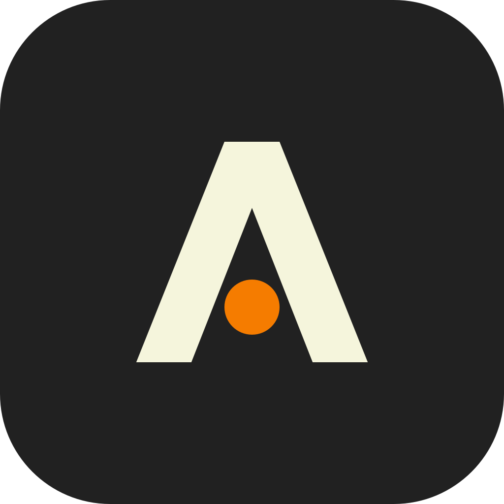

# Align My Astro

*Part of [Jockkie Studio's open-source skills](https://github.com/Jockkie/jockkie-studio). I do the geeking. You get the easy part.*

> **Version 0.1.0, beta.** Tested in Claude; built to the specification of the other platforms but not yet tested there. See [Platform status](#platform-status), and please [report what you find](https://github.com/Jockkie/align-my-astro/issues/new/choose).

A daily reflection skill that weaves Western astrology, the Maya Tzolk'in and Chinese astrology into one reading of today and the past few days, with the moon phase underneath and, if you share them, your dreams. It calculates your profile from your birth date, time and place, and never predicts outcomes: it offers themes, one question and one small practice.

Start by saying something like "make my astro profile" or "what's my reading for today?".

Calculations run locally: the Tzolk'in (GMT correlation), Chinese year and day pillar, sun sign and moon phase need only Python; the natal chart and transits use the optional `pyswisseph` package (AGPL-licensed Swiss Ephemeris, installed separately with `pip install pyswisseph`). Your name, birth data and dreams are never sent to external services.

## Install

The skill folder is `skills/align-my-astro`.

**Claude Code (plugin)**
```
/plugin marketplace add Jockkie/align-my-astro
/plugin install align-my-astro@align-my-astro
```
Want all five Jockkie Studio skills in one go? Use `/plugin marketplace add Jockkie/jockkie-studio` and then `/plugin install align-my-astro@jockkie-studio`.

**Claude.ai**
Zip the `skills/align-my-astro` folder and upload it in Claude's skills settings.

**Hermes Agent (plugin)**
This repository is also a portable [Agent Plugins](https://vercel.com/kb/guide/agent-plugins) package (`plugin.json`, `skills/`, `mcp.json`), which Hermes loads natively. Copy the repository into `~/.hermes/plugins/align-my-astro`, then `hermes plugins enable align-my-astro`. Skill only: copy `skills/align-my-astro` into `~/.hermes/skills/`.

**ChatGPT (Business, Enterprise, Edu)**
Zip the `skills/align-my-astro` folder and upload it under Skills, Create, Upload.

**OpenClaw**
Copy `skills/align-my-astro` into `~/.openclaw/skills/` (or your workspace `skills/` folder) and start a new session.

**Grok**
Import the zipped `skills/align-my-astro` folder under Skills. For Grok Build, copy the folder into `~/.grok/skills/`.

**GitHub Copilot (VS Code, Visual Studio, Copilot CLI, cloud agent)**
Copy `skills/align-my-astro` into `~/.copilot/skills/` for all your projects, or into `.github/skills/` in one repository.

**Codex, Cursor, Gemini CLI and other Agent Skills clients**
Copy `skills/align-my-astro` into the client's skills directory (for example `.agents/skills/`, `.cursor/skills/`, `~/.claude/skills/`).

## Platform status

| Platform | Status | What that means |
|----------|--------|-----------------|
| Claude Code | Validated | The marketplace, manifest and hook pass `claude plugin validate`; the skill was tested in evaluation rounds with Claude models |
| Claude.ai | Skill tested | The same `SKILL.md` as in the evaluations; the zip upload itself is not yet tested |
| Hermes Agent | Untested | Built to the Agent Plugins specification |
| ChatGPT, OpenClaw, Grok, GitHub Copilot | Untested | Built to the Agent Skills format |
| Codex, Cursor, Gemini CLI and others | Untested | Built to the Agent Skills format |

The guard hook only runs in Claude Code. On other platforms, the visible self-check in the skill does that job. Tried it on an untested platform? [Tell us how it went](https://github.com/Jockkie/align-my-astro/issues/new/choose), whether it worked or not.

## How this skill keeps you from trusting a guess

AI tools sound sure of themselves, even when they are guessing. This skill is built to show you the difference:

1. **What you told me and what I assumed.** Every summary and every delivery separates what you said (with your own words), what the skill estimated (with its basis) and what is still unknown.
2. **A check before every step that matters.** Where the skill can run code, `check_dossier.py` or the skill's own script blocks the next step while a fact is labelled as yours without your words or a number has no label.
3. **A visible self-check** before every delivery: sources, invented numbers, one question at a time, files that really exist.
4. **In Claude Code, a guard.** A small hook sends a reply back for a fix when it asks several questions at once, contains an internal note, or claims a file was saved when none was written. It only acts in sessions where this skill is used.

A good habit with any AI advice: before you act on it, ask "Which of this did I tell you, and which did you assume?"

## Privacy

What you share stays with you. Personal data is never sent to external tools, and the files the skill makes are yours to keep.

## Quality

Every change runs the script tests and checks on GitHub (`.github/workflows/tests.yml`). The skill itself is tested with written evaluation cases (`evals/evals.json`) and full simulated conversations, graded by a separate model; results are in `evals/results`.

What changed per version is in the [changelog](CHANGELOG.md). Want to help? Read [CONTRIBUTING](CONTRIBUTING.md). Found a security problem? Report it privately through the Security tab ([how](SECURITY.md)), not in a public issue.

## Credits

The Tzolk'in as kept by Maya day keepers (GMT correlation); Swiss Ephemeris via `pyswisseph` for charts.

## The other skills

| Skill | For |
|-------|-----|
| [Consult Anything](https://github.com/Jockkie/consult-anything) | Owners and managers whose business is stuck |
| [Market This](https://github.com/Jockkie/market-this) | Owners and makers who need more customers |
| [Copywrite Me](https://github.com/Jockkie/copywrite-me) | Anyone who needs a text that sells |
| [Find My Ikigai](https://github.com/Jockkie/find-my-ikigai) | Anyone looking for what makes life worth living |

## Need a human?

The skill refers you to the right type of professional when a problem needs one. Jockkie Studio is one of the options: helicopter view, project management and workflows, process improvement, change and innovation, go-to-market, AI implementation.

## Contact and support

- Website: https://www.jockkie.com
- Email: info@jockkie.com
- The skill is free. If it helped you: https://buymeacoffee.com/jockkie

## License

MIT
